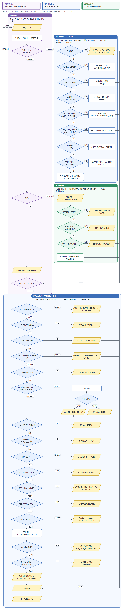
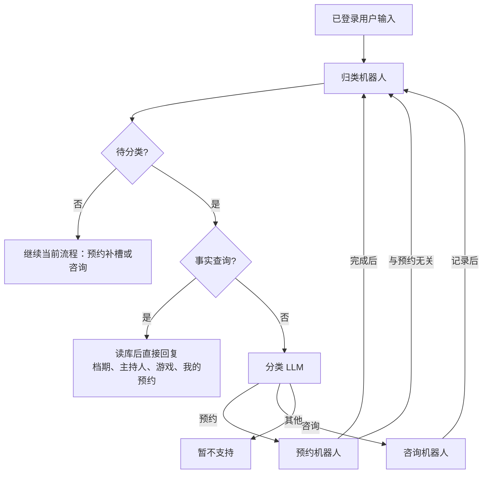
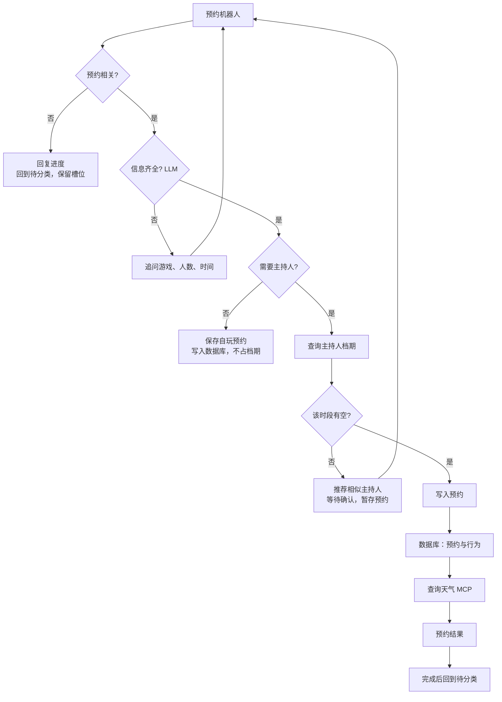
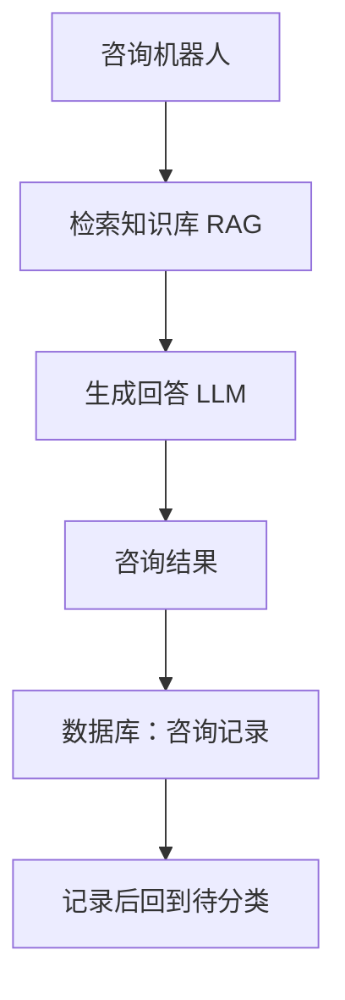

# 归类、预约、咨询流程

> 来源：`architecture .jpg` 的前三栏，作为讨论起点。  
> 范围：预约机器人、归类机器人、咨询机器人。用户行为机器人不在本文。  
> 工作方式：分析和修改以本文为准。当前系统代码只用于最初把图整理出来；后续讨论不要求每轮回去对照代码。代码里已有的做法若与本文冲突，不自动视为正确答案。  
> 状态：工作底稿。文首是一张总流程，归类、预约、咨询接在同一句里。原图收在文末「原图记录」。文末「初始整理备忘」已冻结，不再作为讨论依据。

草稿是约成或取消之前一直带着的那一份。里面有已经填上的槽位，也有「等确认」、被推荐的人，以及「等摘要确认」。这两个标记互斥，不能同时开着；打开其中一个时，先关掉另一个。若读到两个都开着，以「等确认」为准，关掉「等摘要确认」，先不写入。槽位只指这些字段：游戏、人数、时间、时长、主持类型、点名的主持人。带给咨询、约成后清空的是草稿；「还缺游戏」说的是槽位。「等确认」只等用户认不认这位推荐的主持人。「等摘要确认」才等用户认这份完整预约。

每一句先拆句，再对每个片段分别归类。拆句只切片段，不判断整句该去预约还是咨询。归类看当前草稿、是否正在等确认或等摘要确认、上一句问答，给每个片段贴一个意图。槽位类指向预约，问题类指向咨询，进度和闲聊留在归类里回答。咨询里的「读库还是知识库」只作用在问题片段上。

同一句按拆句排出的顺序处理：先槽位，再进度，再闲聊，再问题。片段里的改草稿先落在本句副本上。本句每个片段都成功，副本才替换会话里的旧草稿；任意片段出现没接住的异常，副本整句丢弃，沿用旧草稿，只回复系统异常，本句不再追问、不再落单。咨询里已经接住的「暂时无法查询」是正常结果，不触发这句回滚。全部片段成功之后，才看草稿还缺不缺、能不能落单。回复是一段，处理是分开的。

`has_show_summary` 是会话上的布尔标记，不交给模型判断。输出预约摘要时置为真；槽位被修改时置为假。它为假时，用户说「确认」也忽略，先输出摘要。只有它为真，并且这句确认、又没改槽，才允许写入。

### 总流程

文首三块就是三个机器人各自做什么。紫色归类负责拆句和分流，进度、闲聊自己答。蓝色预约先只改草稿，等这一句的片段都走完才追问；写入前先展示完整预约摘要，等用户确认。绿色咨询只回答问题；进入时带上这个问句片段，以及草稿里已知的槽位，只读不改。查不到或调用失败，就回复暂时无法查询，预约继续。

平行四边形是输入或输出，菱形是判断，矩形是处理。向下是继续判断，向右是这一支的结果。虚线是回路。

预约在图上有两段，仍是同一句。上面遇到槽位只改草稿；走到「没有了」之后才追问或落单。同一句里的问题因此还读得到草稿。



只问某人有没有空、没说要约，走绿色咨询，不开草稿。取消会清空草稿；本句若还有问题，仍汇合后继续。同意主持人或同意摘要，都先记在草稿上，等这一句别的片段答完再往下走。`has_show_summary` 为假时，说「确认」也不算确认，先把摘要展示出来，并把标记置真。

要改流程，改下面的清单，不要改图片。在仓库里运行 `py -3 docs/render_appointment_flow.py`，PNG 会按清单重画。

#### 图的源

```flow
# band 编号 | 颜色 classify/book/consult | 位置 left/right/full | 色块标题
# duty 这一块做什么
# io 输入或输出（平行四边形）  ask 判断（菱形）  step 处理（矩形）  out 讲给用户的结果（平行四边形）
# edge 从 到 down      向下继续
# edge 从 到 right     向右的结果。指向另一个色块时，就是交给那个机器人
# edge 从 到 yes / no  分支内部两个结果并排
# edge 从 到 join      汇到某个节点
# edge 从 到 loop      虚线回路

band classify | classify | left | 归类机器人
duty 拆句，决定每个片段交给谁。进度和闲聊自己回答，不查库。

io input | 已登录，一句输入
step split | 拆句。只切片段，不决定去谁
ask is_slot | 槽位、同意、拒绝或取消？
ask is_question | 是问题？
out chat | 进度或闲聊。归类直接回答
ask more | 还有没处理的片段？

edge input split down
edge split is_slot down
edge is_slot book_cancel right | 交给预约
edge is_slot is_question down | 不是槽位
edge is_question consult_in right | 交给咨询
edge is_question chat down | 否
edge chat more down
edge more sentence_ok down | 没有了
edge sentence_ok sentence_abort right | 有异常
edge sentence_ok has_draft down | 都成功
edge more is_slot loop | 还有片段

band book | book | right | 预约机器人 · 只改草稿
duty 取消、同意、拒绝、改槽，都只改草稿。改槽把 has_show_summary 置假。等确认优先。这里不写入。

ask book_cancel | 是取消？
ask book_agree | 等确认，且同意？
ask book_reject | 等确认，且拒绝？
ask book_change | 等确认，且改时间或改人？
ask book_seen | has_show_summary 为假，却说了确认？
ask book_sum_yes | has_show_summary 为真，且同意？
ask book_sum_no | 等摘要确认，且拒绝？
ask book_sum_edit | 等摘要确认，且改了槽？
step book_plain | 写入普通槽位。标记置假。自助或带上刚查的人
out book_cancelled | 清空草稿，离开预约。本句其余片段继续
step book_noted | 记下同意主持人。两个确认标记都关掉
step book_dropped | 去掉推荐和等确认。其余草稿留下
step book_changed | 去掉推荐，写入新槽。标记置假
step book_seen_skip | 忽略这次确认。has_show_summary 仍为假
step book_sum_noted | 记下已确认摘要，先不写入
step book_sum_dropped | 去掉等摘要确认。草稿留下
step book_sum_changed | 去掉等摘要确认，写入新槽。标记置假

edge book_cancel book_cancelled right | 是
edge book_cancel book_agree down | 否
edge book_agree book_noted right | 是
edge book_agree book_reject down | 否
edge book_reject book_dropped right | 是
edge book_reject book_change down | 否
edge book_change book_changed right | 是
edge book_change book_seen down | 否
edge book_seen book_seen_skip right | 是
edge book_seen book_sum_yes down | 否
edge book_sum_yes book_sum_noted right | 是
edge book_sum_yes book_sum_no down | 否
edge book_sum_no book_sum_dropped right | 是
edge book_sum_no book_sum_edit down | 否
edge book_sum_edit book_sum_changed right | 是
edge book_sum_edit book_plain down | 否

edge book_cancelled more join
edge book_noted more join
edge book_dropped more join
edge book_changed more join
edge book_seen_skip more join
edge book_sum_noted more join
edge book_sum_dropped more join
edge book_sum_changed more join
edge book_plain more join

band consult | consult | right | 咨询机器人
duty 只回答问题。带上问句和已知槽位。调用失败只说暂时无法查询，不改草稿，不阻断预约。

io consult_in | 问题片段，加上草稿里已知的槽位
ask consult_down | 读库或知识库失败？
out consult_fail | 暂时无法查询相关信息。草稿不动
ask consult_db | 档期、档案、人数或时长？
ask consult_kb | 玩法、收费或地址？
step consult_both | 两边都有。读库约束生成，再合成回答
out consult_db_out | 读库，再合成回答
out consult_kb_out | 查知识库，再合成回答

edge consult_in consult_down down
edge consult_down consult_fail right | 是
edge consult_down consult_db down | 否
edge consult_db consult_db_out right | 是
edge consult_db consult_kb down | 否
edge consult_kb consult_kb_out right | 是
edge consult_kb consult_both down | 否

edge consult_fail more join
edge consult_db_out more join
edge consult_kb_out more join
edge consult_both more join

band commit | book | full | 预约机器人 · 片段走完才落单
duty 片段走完才追问。档期可用或自助可约之后，先展示完整预约摘要，等用户确认才写入。

ask sentence_ok | 本句片段全部成功？
out sentence_abort | 系统异常。丢弃本句草稿变更，沿用旧草稿
ask has_draft | 还有进行中的草稿？
out no_draft | 没有草稿，本句结束
ask host_pending | 正在等主持人确认？
out host_still | 不写入。关掉等摘要确认
ask agreed | 本句已同意推荐的主持人？
out sum_after_host | 主持人已定。展示摘要并置真。先不写入
ask rejected | 本句是拒绝推荐？
out stay_reject | 不重查档期。草稿留下
ask sum_ok | has_show_summary，为真且本句确认？
ask sum_rej | 本句拒绝了预约摘要？
out sum_kept | 不写入。草稿留下
ask sum_wait | 已展示摘要，且仍在等确认？
out sum_still | 本句没表态，不写入
ask game | 游戏定了吗？
out ask_game | 先只追问游戏，不问主持
ask people | 人数和时间齐了吗？
out ask_people | 追问还缺的人数或时间
ask occupy | 要占主持人档期吗？
out sum_self | 请确认预约摘要，标记置真。自助不占档
ask host_known | 类型或点名定了吗？
out ask_host | 这时才追问主持类型
ask checknow | 本句要查档吗？
out waiting | 正在等主持人确认，本句没表态，不写入
step lookup | 查档期。点了人则核对他能不能带
ask free | 该时段有空吗？
out sum_free | 展示预约摘要。has_show_summary 置真
ask similar | 点名的人没空，但有相似的人？
out hold | 只标等主持人确认。关掉摘要标记
out nobody | 找不到匹配主持人，请更换条件。槽位都留下
io sentence_end | 本句结束
io next_sentence | 下一句重新拆句

step write_final | 写入预约
ask ok_final | 写入成功？
out done_final | 约成，清空草稿，离开预约
out fail_final | 写入失败，草稿留下

edge has_draft no_draft right | 没有
edge has_draft host_pending down | 有
edge host_pending host_still right | 是
edge host_pending agreed down | 否
edge agreed sum_after_host right | 同意了
edge agreed rejected down | 还没同意
edge rejected stay_reject right | 是
edge rejected sum_ok down | 否
edge sum_ok write_final right | 确认了
edge write_final ok_final down
edge ok_final done_final yes | 成功
edge ok_final fail_final no | 失败
edge sum_ok sum_rej down | 还没确认

edge sum_rej sum_kept right | 是
edge sum_rej sum_wait down | 否
edge sum_wait sum_still right | 是
edge sum_wait game down | 否
edge game ask_game right | 还没有
edge game people down | 定了
edge people ask_people right | 还缺
edge people occupy down | 齐了
edge occupy sum_self right | 自助
edge occupy host_known down | 要主持

edge host_known ask_host right | 没定
edge host_known checknow down | 定了
edge checknow waiting right | 先不查
edge checknow lookup down | 要查
edge lookup free down
edge free sum_free right | 有空
edge free similar down | 没空

edge similar hold right | 有
edge similar nobody down | 没有
edge nobody sentence_end down
edge sentence_end next_sentence down

edge sentence_abort sentence_end join
edge no_draft sentence_end join
edge sum_kept sentence_end join
edge sum_still sentence_end join
edge host_still sentence_end join
edge sum_after_host sentence_end join
edge stay_reject sentence_end join
edge ask_game sentence_end join
edge ask_people sentence_end join
edge sum_self sentence_end join
edge ask_host sentence_end join
edge waiting sentence_end join
edge sum_free sentence_end join
edge hold sentence_end join
edge done_final sentence_end join
edge fail_final sentence_end join

edge next_sentence input loop | 下一句
```

## 归类

先拆句，再对每个片段分别归类。拆句不决定去预约还是咨询。归类给每个片段贴下面四种意图之一，并按这个意图送出。

| 片段意图 | 谁处理 | 草稿 |
| --- | --- | --- |
| 槽位，含同意、拒绝改约、取消 | 预约 | 写入或修改槽位。约成或取消后清空草稿；拒绝推荐只去掉这次推荐和「等确认」；拒绝摘要只去掉「等摘要确认」 |
| 我约到哪了 | 归类直接答 | 进行中则保留；约成之后草稿已空，改读已写下的那场 |
| 纯闲聊 | 归类一句带过 | 不改，不查库 |
| 问题 | 咨询 | 只读带去，不写回 |

没有草稿、也没在预约里时，问题片段仍交给咨询。答完回到本句，继续归类剩下的片段。下一句从拆句重新开始。

归类不把整句截成「事实查询」或「预约 / 咨询 / 其他」。读库还是知识库，由咨询看问题片段再决定。

## 预约进行中的问题

草稿例子：血染，8 人，明天 15:00。用户说：「怎么玩？陈屿有空吗？」

```text
拆句
  |-- 片段一
  |-- 片段二
归类
  |-- 片段一：槽位，没有
  |-- 片段二：问题，玩法；陈屿这个时段有没有空
        |
        v
咨询（只读这份草稿）
  |-- 读库：这款游戏的人数和时长；陈屿在明天 15:00 是否有空
  |-- 知识库：玩法
  |-- 合成一段回答
        |
        v
交回本句，继续归类剩下的片段
  |-- 草稿原样
  |-- 人仍在预约
  |-- 还缺的槽，追问接在这段回答后面
        |
        v
下一句重新拆句
```

带去的是草稿里已经填上的内容：游戏、人数、时间、时长、主持类型、点名的主持人。咨询用它们理解「他」「这个点」「我们这么多人」。

问句里若另写了时间、游戏或主持人，那一组只用于这一次回答。草稿保持不动，除非同一句里还有明确的改槽动作。草稿是明天下午三点，用户说「晚上八点陈屿有空吗」：咨询按晚上八点查陈屿，预约时间仍是下午三点。

「后天呢」「那陈屿呢」不会自动续接上一次查询。下一句重新拆句；归类看得到上一句问答和当前草稿，再决定这是改槽、新问题，还是闲聊。

下一句若是在约局，又没有改点别人，归类把上一句刚查过的那位主持人写入新草稿。这只带上人名，不把上一句的查档续接成同一轮咨询。

## 咨询

咨询只处理被归类成问题的片段。它不接收槽位片段，也不接收「我约到哪了」。进入时除了这个问句片段，还只读带上草稿里已经填好的槽位。读库、知识库和合并见文首总图绿色的咨询机器人。答完回到本句，继续归类剩下的片段。

读库或知识库超时、调用失败，也包括两边合并时读库失败，都回复「暂时无法查询相关信息」。这句兜底是咨询片段的正常结果，不改草稿，不阻断预约，也不触发本句草稿回滚。没接住的异常才整句丢弃草稿变更。

读库的字段是硬约束。人数、档期、主持人档案不能被知识库里的文字改写。咨询不改草稿，也不改里面的槽位，也不把人留在咨询里。

## 何时追问主持人

「要不要主持人」等游戏明确之后才追问。游戏还没定，先追问游戏。

```text
游戏明确了吗
    |
    否 --> 先追问游戏，先不问主持
    |      点了人：先记下人
    |      有没有空交给咨询
    |
    是 --> 看这款游戏
           |
           +-- 本身就是自助 --> 记为自助，不追问，不占档期
           |
           +-- 需要或可选主持
                 |
                 +-- 还没点人、也没说类型 --> 这时才追问
                 +-- 已经点了人 ----------> 核对这个人能不能带这款
```

先说游戏时：这款若属于自助，直接记为自助，不追问，不占档期。这款需要主持，或也可以请人，这时才追问类型。用户已经点了人，就改成核对他能不能带这款，不再问要不要主持。

先冲着某人来时：「陈屿明天下午有空吗」里的有没有空交给咨询。同一句若还表达了要约他，草稿先写下这位主持人，以及已经说出的时间。下一句补游戏。游戏若是自助，不为他占档；若需要主持，核对他能不能带。

只问了有没有空、还没说要预约时，先不开预约草稿。下一句若是在约局，又没改点别人，再把刚查过的那位主持人写入新草稿。

游戏既允许自助也允许请人时，才在游戏明确之后追问要哪一种。目录写明只能自助的，系统直接记成自助。

## 预约落单

游戏、人数、时间补齐，并且主持类型已经按「何时追问主持人」定下来之后，才查档。查档通过或确认为自助之后，先展示完整预约摘要，等用户确认，才写入。

摘要写出游戏、人数、时间、时长、主持类型、点名的主持人或自助。用户还没看见这份摘要就说「确认」，不算数。

```text
游戏、人数、时间已齐
        |
        v
   这款要不要占档
     |          |
    自助       要主持
     |          |
     v          v
  展示摘要    查档期
     |          |
     |          +-- 有空 --> 展示摘要
     |          |
     |          +-- 点名的人没空，有相似的人
     |          |       |
     |          |       v
     |          |   草稿标上「等确认」
     |          |       |
     |          |       +-- 同意 -----------> 展示摘要
     |          |       +-- 拒绝 -----------> 去掉这次推荐
     |          |       +-- 改时间或改人 ---> 去掉这次推荐，按新槽再查
     |          |       +-- 顺便问一句 -----> 咨询只读草稿，确认标记还在
     |          |
     |          +-- 没人 --> 不中断。槽位都留下，提示更换条件
     |
     v
 标上「等摘要确认」，先不写入
     |
     +-- 同意，且 has_show_summary 为真、本句没改槽 --> 写入
     +-- 说了确认，但还没展示过摘要 ----------> 忽略确认，先展示摘要并置真
     +-- 拒绝 ---------------> 去掉「等摘要确认」，草稿留下
     +-- 改了槽 -------------> 去掉标记，按新槽重判
     +-- 顺便问一句 ---------> 标记还在，不写入
     |
     v
 写入成功则约成并清空；失败则草稿留下
     |
     v
 约成，或用户取消
     |
     v
 没有进行中的草稿
 下一句重新进入归类
```

约成包含自助和有主持。两条都要先经过摘要确认，写入完成后才离开预约，草稿清空。下一句不会带上上一单的游戏和时间。「我约到哪了」在约成之后读已经写下的那场，不靠这份草稿。

没约成时人留在预约里。没人可顶、用户拒绝推荐、用户拒绝摘要、保存失败，游戏、人数、时间都还在。拒绝推荐只清掉「等确认」和被推荐的那位。拒绝摘要只清掉「等摘要确认」。

「等确认」和「等摘要确认」互斥，同一份草稿不能同时开着。打开其中一个时，先关掉另一个。推荐主持人时只开「等确认」；用户同意这位主持人后，关掉「等确认」，再展示摘要并只开「等摘要确认」。若读到两个都开着，以「等确认」为准，关掉「等摘要确认」，先不写入。

「等确认」只表示在等用户认不认这位推荐的主持人，同意之后仍然先展示摘要，不直接写入。「等摘要确认」才表示摘要已经给人看过。`has_show_summary` 在摘要真正输出时置真，槽位一改就置假。它为假时忽略「确认」。同一句里如果又改了槽，刚才的确认作废，齐了就重新展示摘要，并把标记先置假、输出新摘要时再置真。旁边问一句仍然交给咨询，人留在预约里，对应的标记不动。

点名的人没空，又没有相似主持人时，流程不中断。游戏、人数、时间、时长、主持类型和点名的人都留下，回复「找不到匹配主持人，请更换条件」。下一句仍从拆句进入。

用户取消则离开预约，草稿清空。

## 状态

| 事件 | 下一状态 | 草稿 |
| --- | --- | --- |
| 任一句话 | 先归类 | 原样带入归类 |
| 拆出槽位、改约确认或取消 | 留在预约 | 按这句话改 |
| 拆出「我约到哪了」 | 答完后重新进入归类 | 进行中则保留草稿；约成之后草稿已空，改读已写下的那场 |
| 拆出纯闲聊 | 状态不变 | 不改 |
| 预约进行中拆出问题 | 人留在预约；咨询只读草稿后交回归类 | 不改，除非同一句另有改槽 |
| 咨询读库或知识库失败 | 人留在预约，预约继续 | 不改。回复暂时无法查询相关信息 |
| 没有草稿时拆出问题 | 咨询答完交回归类 | 无 |
| 同一句答完仍缺槽 | 留在预约 | 保留，追问接在回答后面 |
| 游戏未明 | 留在预约或等待开草稿 | 先追问游戏，不问要不要主持 |
| 游戏属于自助且尚未写入 | 留在预约 | 主持类型记为自助，不占档期 |
| 游戏需要或可选主持，且未点人 | 留在预约 | 这时才追问主持类型 |
| 上一句只查了某位主持人，这一句开始约局且没改点别人 | 进入预约 | 把刚查过的主持人写入新草稿 |
| 约成（含自助）或用户取消 | 离开预约，下一句重新进入归类 | 清空 |
| 槽位齐，且自助可约或档期有空 | 留在预约 | 展示完整预约摘要，标上「等摘要确认」，不写入 |
| 等摘要确认且用户同意，本句没改槽 | 写入预约 | 成功则清空离开；失败则保留，确认标记还在 |
| 等摘要确认且用户拒绝 | 留在预约 | 去掉「等摘要确认」，槽位保留 |
| 等摘要确认且改了槽 | 留在预约 | 去掉「等摘要确认」，按新槽重判；齐了就重新展示摘要 |
| 等摘要确认且只是提问 | 人留在预约 | 「等摘要确认」不动，不写入 |
| 没人可约，点名的人没空且没有相似主持人 | 留在预约，不中断 | 槽位全部保留。回复找不到匹配主持人，请更换条件 |
| 没人可约，或写入失败 | 留在预约 | 保留 |
| 本句有片段出现没接住的异常 | 沿用会话旧草稿 | 丢弃本句全部草稿变更。只回复系统异常 |
| has_show_summary 为假时用户说确认 | 留在预约 | 忽略确认，先展示摘要并把标记置真 |
| 输出预约摘要 | 留在预约 | has_show_summary 置真，不写入 |
| 槽位被修改 | 留在预约 | has_show_summary 置假 |
| 拒绝推荐 | 留在预约 | 保留游戏、人数、时间；去掉「等确认」和被推荐的人 |
| 等确认时改时间或改人 | 留在预约，按新槽再查档 | 去掉这次推荐，写入新槽 |
| 等确认时顺便提问 | 人留在预约 | 只留「等确认」。若同时标着「等摘要确认」，关掉摘要标记 |
| 等确认和等摘要确认同时出现 | 留在预约 | 以「等确认」为准，关掉「等摘要确认」，不写入 |

## 待决问题

已经定下来的：

1. **咨询不跨轮。** 答完回到本句，继续归类还没处理的片段。下一句从拆句重新开始，不留在咨询里。
2. **预约进行中的问题。** 问题片段交给咨询，人留在预约里。草稿只读带去，咨询不改草稿。问句里另写的时间、游戏或主持人只用于这一次回答，不写入槽位。读库或知识库超时、调用失败，回复「暂时无法查询相关信息」，不改草稿，不阻断预约。
3. **事实查询放进咨询。** 归类不再用事实查询截走整句。档期、档案、人数时长读库；玩法、收费、地址走知识库；两边都有则合并。读库约束生成。
4. **主持类型等游戏明确后再追问。** 自助项目直接记为自助，不追问，不占档期。需要或可选主持时才追问；已经点了人就改成核对。先问某人有没有空不必先开草稿；下一句若开始约局且没改点别人，把刚查过的主持人写入新草稿。
5. **落单出口。** 自助可约或档期有空之后，先展示完整预约摘要，`has_show_summary` 置真，用户在见过摘要之后确认、且本句没改槽，才写入。约成（含自助）和用户取消：离开预约，草稿清空。点名的人没空且没有相似主持人：不中断，槽位全部留下，回复「找不到匹配主持人，请更换条件」。没人可约、拒绝推荐、拒绝摘要、写入失败：留在预约，草稿保留。拒绝推荐只去掉「等确认」和被推荐的人。拒绝摘要只去掉「等摘要确认」。改时间或改人则去掉这次推荐或这次摘要确认，按新槽再查。「等确认」和「等摘要确认」互斥，不能同时开；打开一个先关掉另一个。两个都开着时以「等确认」为准，关掉「等摘要确认」，先不写入。约成之后「我约到哪了」读已写下的那场。
6. **先拆句，再分别归类。** 拆句只切片段，不判断整句去哪。然后对每个片段归类：槽位类指向预约，问题类指向咨询，进度和闲聊留在归类。读库还是知识库只在咨询里判断。
7. **草稿和槽位。** 草稿是约成或取消前带着的那一份，含已填槽位，以及「等确认」、被推荐的人、「等摘要确认」。后两个标记互斥。另有会话布尔标记 `has_show_summary`：输出摘要时置真，槽位修改时置假；为假时忽略「确认」，先展示摘要。槽位只指游戏、人数、时间、时长、主持类型、点名的主持人。
8. **本句草稿原子性。** 片段改动先写在本句副本上。全部片段成功，副本才替换旧草稿。任一没接住的异常，副本丢弃，沿用旧草稿，只回复系统异常，本句不追问、不落单。已经接住的咨询失败不算这种异常。
9. **没有相似主持人。** 点名的人没空且没有相似的人时不中断，槽位全部留下，回复「找不到匹配主持人，请更换条件」。

还没定的：目前没有。

## 原图记录

下面是 `architecture .jpg` 前三栏的原样，只作起点。和正文冲突时，以正文为准。

每一句先进入归类。待分类为否时，原图写的是继续预约补槽或继续咨询。待分类为是时，先做事实查询；否则分类模型只产出预约、咨询、其他。



预约原图：



原图这条链路的含义：

1. 先问这句话是不是还在办预约。
2. 不是预约相关：回复当前进度，回到待分类，已经填过的槽位留下。
3. 是预约相关：由 LLM 判断游戏、人数、时间是否齐全。不齐就追问这三项，再回到预约机器人。
4. 齐全之后看要不要主持人。不要则记成自玩预约，写入数据库，不占用档期。要则查主持人档期。
5. 档期有空：写入预约和用户行为，再查天气，给出预约结果，然后回到待分类。
6. 档期没空：推荐相似主持人，等用户确认，预约先暂存，再回到预约机器人继续。

原图没有画出的出口：保存失败、没有相似主持人、用户拒绝推荐。

咨询原图是一条直线：检索知识库、生成回答、写下咨询记录、回到待分类。没有「读库还是知识库」的分叉，也没有把草稿带进咨询。



## 初始整理备忘

以下内容是最初对照当时代码留下的备忘，已经冻结。后续讨论不以这一节为依据。

**每一句都会进归类入口，但不会都走分类。** 状态已是预约时，下一句跳过事实查询和分类 LLM，直接进预约机器人补槽。咨询在成功回答后当轮就回到待分类，所以下一句会重新走归类。

**预约可以跳出，出口在预约机器人内部。** 进度问题会回待分类并保留槽位。抽槽结果被标成无关时，同一句会交回归类重判。成功、无人可约、拒绝推荐、保存失败会回待分类，并清空槽位。正在等待主持人确认时，新的一句只用来回答「是 / 不」，不能改槽，也不能转去咨询。

**图上「预约相关？否 → 回复进度」把两件事画成一支。** 代码里，进度问题是单独的第一道门；无关的话是抽槽之后的另一道门，回复的是转交，不是进度。抽槽发生在无关判断之前，无关句仍可能改掉已有槽位。

**「信息齐全」不是模型说了算。** 模型负责抽槽。齐不齐、人数和主持类型是否符合这款游戏，由代码判断。时长没说时会用游戏的建议时长。图上的追问只写了游戏、人数、时间。

**「该时段没空就推荐相似主持人」只覆盖点名冲突。** 没点名时，同类型有空就直接落单。完全没人时直接失败。推荐确认用子串匹配「是 / 不」，「不行」「不可以」「不好」会同时命中两边，确认停住。拒绝或失败后的话术让用户换时间，槽位却已被清空。

**自玩「写入数据库，不占档期」只做到了不占档期。** 没有主持人时保存直接成功，不写档期表，只在行为表留一条记录。同一时段可以重复自玩成功。

**有主持的成功路径与图一致：** 先写档期和行为，再查天气，然后回待分类。天气失败不回滚预约。图上的 MCP 在代码里是直接调用天气接口的工具。

**归类的事实查询只在待分类时发生。** 补槽过程中的档期、人数、主持人问题进不了这道查库。没被规则接住的同类问题会进咨询，由检索和生成回答。分类模型还会产出图上没有的 `pay`、`statistics`，出口与「其他」一样，是暂不支持。

**咨询图是直线，代码多一道门。** 进入咨询后会再判一次是不是咨询；判否就把同一句交回归类。咨询没有跨轮状态，答完即回待分类。
