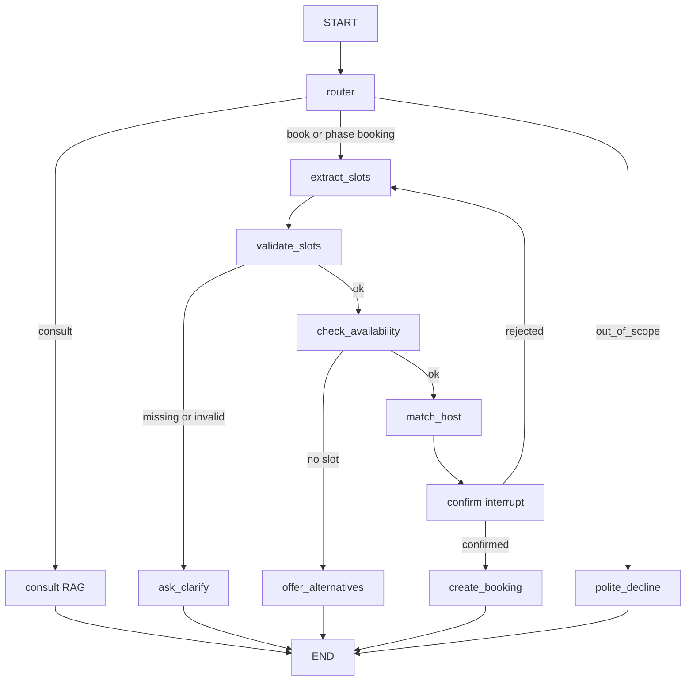

# 桌游预约智能客服系统 — 产品与技术 Spec（Greenfield）

> 版本：0.1  
> 状态：草案（供 Vibe Coding 从零实现）  
> 参考：本仓库 Smart Appointment AI Agent 的业务拆分与分层思想；编排采用 LangGraph + 结构化槽位（不复制 legacy 四 Agent 类写法）。

---

## 1. 背景与目标

### 1.1 业务场景

线下桌游门店需要同时处理：

- **咨询**：游戏规则、人数、时长、是否必须主持人、收费方式。
- **预约**：选择 **桌游项目**、**主持人类型**、时段、玩家人数，确认档位/房间并落单。

### 1.2 产品目标（MVP）

- 用户用自然语言完成 **咨询** 或 **预约**。
- 预约路径支持 **多轮补槽**、**主持类型合法性校验**、**档期冲突处理**、**确认后写库**。
- 流式对话体验；前端使用 **SSE + JSON 事件**（不复刻 `[THOUGHT]`/`[REPLY]` 字符串协议）。

### 1.3 非目标（MVP 不做）

- 多门店租户、复杂会员与支付闭环。
- 实时语音、小程序双端（可先 Web）。
- 完整改约/取消工作流（路由可识别，回复引导人工或二期实现）。

---

## 2. 术语表

| 术语 | 定义 |
|------|------|
| 桌游项目 | 可预约的游戏 SKU（名称、人数上下限、推荐时长等） |
| 主持类型 | 服务方式枚举：专业主持 / 店员带玩 / 自助 / 少儿向主持 |
| 场次 | 时间窗 + 桌位/房间 + 玩家数 + 关联游戏与主持 |
| 槽位（Slots） | 预约所需结构化字段集合 |
| 图状态 | LangGraph checkpoint 中持久化的 `phase`、`slots`、`draft` 等 |

---

## 3. 主持类型与桌游约束

### 3.1 主持类型枚举

| 值 | 显示名 | 说明 |
|----|--------|------|
| `pro_host` | 专业主持人 | 带规则讲解、控场，适合熟人局以外、重策略或剧本类 |
| `staff_guide` | 店员带玩 | 轻度主持，适合 party 类、入门玩家 |
| `self_play` | 自助 | 仅租桌+游戏，无专人带局 |
| `kids_host` | 少儿向主持 | 儿童向游戏与节奏 |

### 3.2 桌游项目数据（Catalog）

每条游戏至少包含：

- `game_id`, `name`
- `min_players`, `max_players`
- `duration_min`（建议时长，分钟）
- `needs_host`（是否强烈建议有人带）
- `allowed_host_types[]`（允许的主持类型子集）

**规则示例（实现须覆盖）**

- 用户选择 `pro_host`，但游戏 `allowed_host_types` 不含该项 → 校验失败并澄清。
- `player_count` 不在 `[min_players, max_players]` → `invalid_fields` 并追问。

---

## 4. 系统架构

### 4.1 分层（沿用五层，禁止下层调上层）

```text
Web → API → Agents(Graph) → Services → DB
```

| 层 | 职责 |
|----|------|
| Web | 聊天页、可选 catalog 下拉 |
| API | SSE 流式聊天、预约 CRUD、游戏目录查询 |
| Agents | LangGraph：路由、咨询、预约子流程 |
| Services | 游戏目录、主持匹配、档期、预约、知识库 |
| DB | SQLite/Postgres：游戏、主持人、档期、预约单 |

### 4.2 编排模型

- **一个** LangGraph 编译图，**多个专职节点**（逻辑上对应多 Agent，实现上不强制多个 `*Agent.py`）。
- 会话：`thread_id` + **Checkpointer**（开发用 MemorySaver，生产可 SQLite）。
- LLM：OpenAI-compatible；槽位提取与路由优先 **structured output（Pydantic）**。

### 4.3 逻辑节点与按摩房项目映射

| 本 Spec 节点 | 参考本仓库模块 |
|-------------|----------------|
| `router` | `task_classification/task_classifier.py` |
| `consult` | `consultant/*` + RAG |
| `extract_slots` / `validate_slots` | `appointment/input_parser.py` |
| `match_host` / `availability` | `appointment/technician_finder.py` |
| `confirm` / `write_booking` | `appointment/appointment_processor.py` + DB |
| 行为分析（异步） | `user_behavior_agent.py`（不进主图热路径） |

---

## 5. 目录脚手架（Greenfield）

```text
boardgame-agent/
├── .cursor/skills/setup-environment/
├── app.py
├── config/
│   ├── settings.py
│   ├── model_provider.py
│   └── feature_flags.py
├── api/
│   ├── chat.py                 # POST /chat/stream → SSE
│   └── catalog.py              # 游戏列表、主持类型说明
├── agents/graph/
│   ├── state.py
│   ├── schemas.py              # 本文第 6 节模型
│   ├── builder.py
│   ├── runner.py
│   ├── stream_adapter.py       # 图事件 → SSE JSON
│   └── nodes/
│       ├── router.py
│       ├── consult.py
│       └── book/
│           ├── extract_slots.py
│           ├── validate.py
│           ├── availability.py
│           ├── recommend_host.py
│           └── confirm.py
├── services/
│   ├── game_catalog_service.py
│   ├── host_matching_service.py
│   ├── booking_service.py
│   └── knowledge_service.py
├── db/
│   ├── models.py
│   └── repositories/
├── web/templates/index.html
├── evals/
│   ├── golden_dialogues.yaml
│   └── run_eval.py
├── .env.example
└── requirements.txt
```

---

## 6. 数据契约（Pydantic）

### 6.1 路由

```python
class DialogPhase(str, Enum):
    IDLE = "idle"
    BOOKING = "booking"
    AWAIT_CONFIRM = "await_confirm"

class UserIntent(str, Enum):
    CONSULT = "consult"
    BOOK = "book"
    MODIFY = "modify"
    CANCEL = "cancel"
    CHITCHAT = "chitchat"
    OUT_OF_SCOPE = "out_of_scope"

class RouteDecision(BaseModel):
    intent: UserIntent
    confidence: float = Field(ge=0, le=1)
    reason: str = Field(max_length=120)
```

### 6.2 主持类型

```python
class HostType(str, Enum):
    PRO_HOST = "pro_host"
    STAFF_GUIDE = "staff_guide"
    SELF_PLAY = "self_play"
    KIDS_HOST = "kids_host"
```

### 6.3 预约槽位

```python
class BookingSlots(BaseModel):
    game_name: str | None = None
    game_id: str | None = None
    host_type: HostType | None = None
    host_preference: str | None = None   # 自然语言偏好，匹配时参考
    start_time: datetime | None = None
    duration_minutes: int | None = Field(None, ge=60, le=360)
    player_count: int | None = Field(None, ge=1, le=20)
    contact_name: str | None = None
    contact_phone: str | None = None
    notes: str | None = None
```

### 6.4 校验结果

```python
class SlotValidation(BaseModel):
    is_complete: bool
    missing_fields: list[str]
    invalid_fields: list[str]
    clarify_question: str
```

### 6.5 推荐与草稿

```python
class HostRecommendation(BaseModel):
    host_type: HostType
    host_id: str | None
    host_display_name: str
    rationale: str
    requires_user_confirm: bool = True

class BookingDraft(BaseModel):
    slots: BookingSlots
    recommended_host: HostRecommendation | None
    table_id: str | None
    price_estimate: float | None
```

### 6.6 LangGraph 状态（TypedDict 摘要）

```python
class GraphState(TypedDict, total=False):
    thread_id: str
    phase: DialogPhase
    last_intent: UserIntent
    slots: dict            # BookingSlots.model_dump()
    draft: dict            # BookingDraft.model_dump()
    pending_confirm: bool
    user_input: str        # 当前轮用户输入
```

---

## 7. LangGraph 主流程



### 7.1 条件路由（入口）

- `phase == AWAIT_CONFIRM` 或 `BOOKING` 且 `pending_confirm` → 优先进入 `confirm` / `extract`（按用户回复解析是/否或改口）。
- `phase == BOOKING` → 直达 `extract_slots`（跳过 router 或 router 仅作兜底）。
- 否则 → `router`（structured `RouteDecision`）。

### 7.2 确认（HITL）

- 推荐主持人类型/具体主持人不可用时，生成 `BookingDraft`，`pending_confirm=true`，`phase=AWAIT_CONFIRM`。
- 用户确认后 `create_booking`；拒绝则清空部分槽位或重新 `match_host`。

---

## 8. Tools / 服务接口

| 名称 | 层 | 说明 |
|------|-----|------|
| `resolve_game(name)` | Service | 模糊匹配 → `game_id`，返回人数与 `allowed_host_types` |
| `list_host_types()` | Service | 枚举及说明文案 |
| `check_table_availability(slots)` | Service | 时段+人数+时长 → 可用桌位列表 |
| `match_hosts(game_id, host_type, time, preference)` | Service | 主持人候选与推荐理由 |
| `create_booking(draft)` | Service | 持久化预约单 |
| `kb_search(query)` | Service | RAG：规则、收费、包厢政策 |

**MCP（二期）**：将 `schedule` / `kb` 拆为 MCP Server；MVP 可用同进程 function tool。

---

## 9. API 与前端协议

### 9.1 HTTP

| 方法 | 路径 | 说明 |
|------|------|------|
| POST | `/chat/stream` | Body: `{ "message": string, "thread_id"?: string }`，响应 `text/event-stream` |
| GET | `/api/games` | 游戏目录 |
| GET | `/api/host-types` | 主持类型说明 |

### 9.2 SSE 事件类型（每条 `data: {json}\n\n`）

| type | 载荷 | 说明 |
|------|------|------|
| `assistant_delta` | `{ "text": string }` | 助手文本增量 |
| `slot_update` | `{ "slots": object }` | 结构化槽位更新（供 UI 展示） |
| `confirm_required` | `{ "draft": object }` | 需要用户确认 |
| `tool` | `{ "name", "status", "detail"? }` | 工具调用状态 |
| `error` | `{ "message": string }` | 错误 |
| `done` | `{ "thread_id": string }` | 本轮结束 |

---

## 10. 数据模型（DB 摘要）

### 10.1 表（MVP）

- **games**：游戏 catalog（见 3.2）
- **hosts**：主持人 id、display_name、skills[]、`host_types[]`、排班引用
- **tables**：物理桌/房间、容量
- **bookings**：game_id、host_id 可空、table_id、start/end、player_count、contact、status
- **knowledge_chunks**：RAG 片段（可选 category）

### 10.2 预约状态

`pending` | `confirmed` | `cancelled`（MVP 至少 `confirmed`）

---

## 11. 配置与环境

`.env.example` 至少包含：

- `MODEL_PROVIDER`, `LLM_*`, `EMBEDDING_*`（咨询 RAG 与路由）
- `DATABASE_URL`
- `USE_LANGGRAPH=1`（Greenfield 默认开启图编排）

Python：**3.10–3.12**（与 LangChain 0.3 / LangGraph 0.2 兼容策略一致时可锁版本）。

---

## 12. 评测与质量

### 12.1 黄金对话（`evals/golden_dialogues.yaml`）

至少 **20 条**，覆盖：

1. 纯规则咨询 → `CONSULT`，不进入 `BOOKING`
2. 一次性说清：游戏 + 时间 + 人数 + `pro_host`
3. 人数超上限 → `invalid_fields`
4. 游戏不允许 `pro_host` → 澄清或改 `host_type`
5. 主持满员 → 推荐备选类型/时段，进入 `confirm_required`
6. 多轮补槽：仅游戏名 → 追问时间、人数、主持类型
7. `OUT_OF_SCOPE` 礼貌拒绝
8. 确认轮：用户回复「好/不要/改时间」

### 12.2 指标（离线）

- 路由准确率（intent/phase）
- 槽位 F1（字段级）
- 预约完整对话成功率（golden 集）
- RAG 回答含引用率（consult 路径）

---

## 13. 实现里程碑（建议）

| 阶段 | 交付 |
|------|------|
| M1 | FastAPI + SSE 骨架 + `RouteDecision` stub |
| M2 | `BookingSlots` + extract/validate + 多轮追问 |
| M3 | 内存 catalog + `resolve_game` + HostType 校验 |
| M4 | availability/match_host stub + confirm interrupt + 写库 |
| M5 | RAG consult + 知识管理最小 UI |
| M6 | golden_dialogues 自动化 + README |

---

## 14. 安全与合规（简表）

- 预约手机号仅存 DB，日志脱敏。
- RAG 提示词注入：检索结果与系统指令分离；禁止执行用户嵌入的工具指令。
- 无 LLM Key 时接口 fail fast，不降级到伪造预约成功。

---

## 15. 与 Smart Appointment AI Agent 的差异摘要

| 维度 | 按摩房参考项目 | 桌游 Greenfield |
|------|----------------|-----------------|
| 匹配对象 | 技师 | 主持人类型 + 可选具体主持人 |
| 核心槽位 | 项目/时长/性别/技师名 | 游戏/主持类型/人数/时长 |
| 编排 | legacy router + 可选 LangGraph | LangGraph 为一等公民 |
| 流式协议 | 文本 token 前缀 | SSE JSON 事件 |
| 槽位提取 | LLM JSON 文本 | Pydantic structured output |
| 确认 | `awaiting_confirmation` 字段 | `AWAIT_CONFIRM` + interrupt |

---

## 16. 文档维护

- 实现偏离本 Spec 时，应先更新本节或提交变更说明。
- 关联技能：可在新仓库复制 `.cursor/skills/setup-environment` 模式。

---

**附录 A：示例用户话术（验收）**

- 「想了解《血染钟楼》适合几个人玩多久？」→ 咨询 + 知识引用  
- 「周六下午想约晴日岛，4 人，要专业主持。」→ 预约 + 校验 + 档期 + 确认  
- 「我们 2 个人想玩卡卡颂，自己看规则就行。」→ `self_play` + 人数校验
